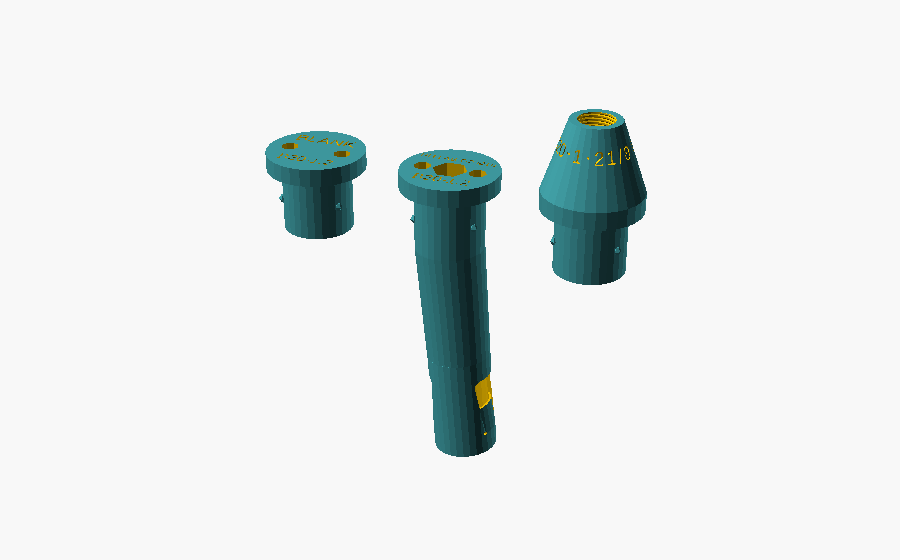

# bayonet-port-scad

OpenSCAD bayonet ports for lab vessels, built on
[bayonet-lock-scad](https://github.com/CameronBrooks11/bayonet-lock-scad). A port is a lock half
cut into a panel and a pin half that twists into it, sealed by an o-ring. Variants take a probe in a
flex collet, a thermocouple on an NPT mount, or a baffle plate.




## Contents

| File | What it gives |
| --- | --- |
| `custom/bayonet_port.scad` | `bayonet_port()`, the pin and lock halves with flange, o-ring seal and labels; `bayonet_probe_port()`, `bayonet_thermocouple_port()`, `bayonet_baffle_port()`, `npt_thread_mount()`; the interface accessors |
| `custom/bayonet_interfaces.scad` | the interface records: `bayonet_std`, `bayonet_mini`, `bayonet_midi`, `bayonet_large`, `bayonet_xl` |
| `custom/cylindrical_flex_collet.scad` | the flex collet a probe port holds its probe in |
| `purchased/orings.scad`, `purchased/oring.scad` | the o-ring registry and its accessors |
| `purchased/atlas_probes.scad`, `purchased/atlas_probe.scad` | the Atlas Scientific probe registry the probe ports are cut for |
| `utils/oring_gland.scad` | o-ring gland width and depth |
| `utils/npt_threads.scad` | NPT taper threads, ASME B1.20.1 |
| `utils/registries.scad`, `utils/facets.scad`, `utils/dovetail.scad`, `utils/trapezium.scad` | helpers the files above use |

Every port is drawn in its own datum: z = 0 at the panel's outer face, +z outward. A consumer
places one with a single translate to the hole's centre. `examples/ports.scad` draws a blank std pin,
a probe port and a thermocouple port.

## Use

With [scadman](https://github.com/CameronBrooks11/scadman):

```sh
scadman add bayonet-port-scad https://github.com/CameronBrooks11/bayonet-port-scad --tag v0.1.0
scadman lock && scadman sync
```

```openscad
include <bayonet-port-scad/custom/bayonet_interfaces.scad>
use <bayonet-port-scad/custom/bayonet_port.scad>

bayonet_port(type=bayonet_std, part="pin", panel_thickness=18);
```

The library pins its own dependencies, bayonet-lock-scad and threads-scad, in `scadman.toml`, so a
consumer lists only this library.

## Develop

```sh
just setup   # install the pinned libraries into .scadman/env
just check   # check the formatting, then render every file and fail on any error or warning
just test    # render the example to a mesh, then check both halves of every interface
just fmt     # format the .scad files with topiary 0.8.0
just images  # render the picture above into docs/img/
```

`just test` renders the example on CGAL, which reports a solid that is not 2-manifold. It then
renders the pin and lock halves of `bayonet_std`, `mini`, `midi`, `large` and `xl`. Each half must be
one solid with no warning or error, and each pin as wide as its flange.

CI runs `just check` and `just test` on the OpenSCAD snapshot it pins (2026.10.15).

## Origin and licence

These files come from [open-source-bioreactor](https://github.com/uwo-fast/open-source-bioreactor),
whose lid ports they are, at commit f3c35f0.

GPL-3.0-or-later: [`LICENSE`](LICENSE), also in [`LICENSES/`](LICENSES/).
